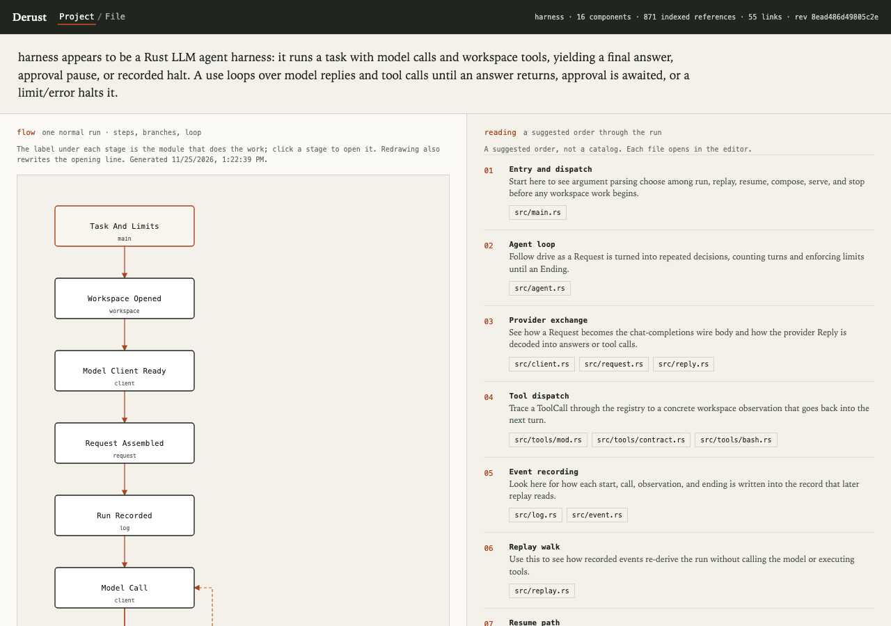
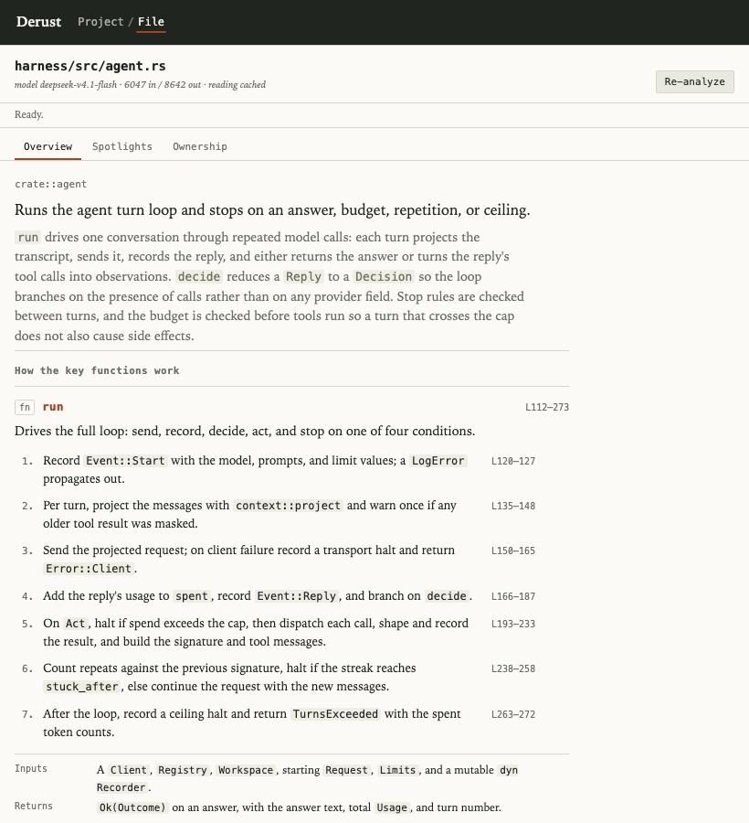

# Derust

Derust is a VS Code extension for reading unfamiliar Rust. One panel explains a
workspace from the top down: what the project is and how a normal run flows,
then the file you open — module behavior, key operations, Rust syntax and
ownership.

## What it is

Derust has one panel with two modes, switched from its header:

- **Project** — the crate-level view: an opening line that names the project and
  what one use does, a flow diagram of one normal run (stages, decisions,
  branches and loops, each labelled with the module that does the work), and a
  suggested reading order for understanding the run.
- **File** — the current file, in three tabs:
  - **Overview** — the module reading: role, purpose, boundaries, key
    operations, walkthroughs for the key functions, and the rules that need
    explaining. Before a reading exists it shows a deterministic structural
    overview built from the source.
  - **Spotlights** — the Rust constructs that are easy to misread: lifetimes,
    borrows and moves, async, trait objects, derives, attributes, and dense
    idioms. Each says what it means, what it expands to, and the common trap.
  - **Ownership** — memory models for the key functions, with lifetimes, moves,
    borrows, clones, heap objects, and a stack/heap snapshot at the current
    line.

The reading uses a workspace index built through rust-analyzer for module paths,
public surface, callers, callees, tests, imports, and crate dependencies. The
structural index is built first and cached locally. Call-graph relations are
refreshed in the background and are used by the next reading; the first reading
can use the structural packet while those relations are still being built.

The panel opens with the work already running. **Project** draws the flow and
plans the reading order together, then writes the opening line from the flow;
**File** starts Read & Analyze, generating the module reading and the
Spotlights/Ownership analysis in parallel. Cached results are reused, so
reopening is instant; the pane buttons force a redraw or a fresh analysis.

## The panel

One panel, two modes. The header stays in place; click **Project** or **File**.



*Project: the opening line at the top, the flow of one normal run on the left —
each stage labelled with the module that does the work — and a suggested reading
order on the right. Both are planned automatically when the view opens.*



*File: the module reading, Rust construct spotlights and the ownership timeline
for the current file. Read & Analyze starts by itself; the tabs and scrolling
work in the same panel.*

## Install

From the Marketplace, search for **Derust**, or install the local VSIX:

```bash
code --install-extension release/derust-0.9.0.vsix
```

For development, open this folder in VS Code and press `F5`.

## Configure

The first AI request — Analyze Architecture, Read & Analyze, or the analysis
that starts when a view opens — asks for the provider settings in VS Code:

1. **Base URL** — an OpenAI-compatible endpoint, for example
   `https://api.openai.com/v1`. Derust appends `/chat/completions`, so do not
   include that path. It is saved to `derust.baseUrl`.
2. **Model** — the model id sent to the provider, saved to `derust.model`.
3. **API key** — stored in VS Code **SecretStorage**, never in `settings.json`.

The URL and model live in your user settings, where they can be edited or
synced. The key is held by VS Code's secret store and applies to every AI
request.

Run **Derust: Configure Provider** at any time to change them; leave the key
blank there to keep the current one.

### Settings

| Setting | Default | Purpose |
|---|---|---|
| `derust.baseUrl` | empty | OpenAI-compatible provider base URL. |
| `derust.model` | empty | Model id sent to the provider. |
| `derust.timeoutSeconds` | `300` | Timeout for one provider request. |
| `derust.maxOutputTokens` | `32768` | Output cap. Reasoning models spend part of it before writing JSON. |
| `derust.reasoningEffort` | `low` | `none`, `low`, `medium`, or `high`; dropped if the provider rejects it. |
| `derust.maxFileLines` | `1200` | Files above this are refused for analysis. |
| `derust.includeDocs` | `true` | Send `DESIGN.md`, `README.md`, and `Cargo.toml` as project context. |
| `derust.jsonMode` | `true` | Request JSON mode; falls back if the provider rejects it. |
| `derust.concurrency` | `2` | Files analyzed in parallel for folder/workspace runs. |
| `derust.maxFiles` | `20` | Ask before a folder/workspace run exceeds this count. |
| `derust.defaultLayout` | `cards` | Spotlight layout: `cards` or `columns`. |
| `derust.restoreLastAnalysis` | `true` | Reopen the last cached reading or analysis at startup. |
| `derust.colorCode` | `true` | Color identifiers in the editor to match memory lanes. |
| `derust.overviewGlance` | `true` | Show the one-line Overview link above the first source line. |
| `derust.autoAnalyze` | `true` | Start Read & Analyze when a file's Derust view opens; cached results are reused. |
| `derust.briefOnOverview` | `true` | With `autoAnalyze` off, start only the module reading when the Overview opens. |

Provider note: reasoning models can consume the whole output budget before
emitting JSON. If a request returns an empty message, raise
`derust.maxOutputTokens` or lower `derust.reasoningEffort`.

Release notes are in [CHANGELOG.md](CHANGELOG.md).

## Key commands

| Command | What it does |
|---|---|
| **Derust: Read & Analyze Current File** | Forces a fresh run for the active file. Normally starts automatically when the File view opens. Shortcut: `Cmd/Ctrl+Alt+R`. |
| **Derust: Analyze Path…** | A single selected `.rs` file uses Read & Analyze; a folder runs analysis for selected files. |
| **Derust: Analyze Workspace** | Runs the Spotlights/Ownership analysis for selected files in the workspace. |
| **Derust: Analyze Architecture** | Builds the project view from the analyzed source: an opening line written from one normal run, a flow diagram of that run (stages, decisions, labelled branches and loops, each stage labelled with the module that does the work and clickable to open it in the editor), and a five-to-eight step reading order for the run. The opening line is written from the flow alone — stage titles, kinds, descriptions and transitions, plus the derived archetype and entry point; comments and source never shape it. Running the command opens the view and starts the work: the flow and the
reading order are planned together, and the opening line is written from the
flow when it is ready. Cached results show immediately; the pane buttons force
a redraw or replan. |
| **Derust: Open Panel** | Opens the cached reading or structural overview for the active Rust file. |
| **Derust: Show File Overview** | Opens the Overview; with `derust.autoAnalyze` on, the analysis starts by itself. |
| **Derust: Rebuild Workspace Index** | Forces a fresh rust-analyzer index. |
| **Derust: Show Index Packet** | Opens the index evidence for the current file. |
| **Derust: Configure Provider** | Asks for the base URL, model and API key; settings go to VS Code settings, the key to SecretStorage. |
| **Derust: Clear Analysis Cache** | Removes cached analyses and readings. |

## Navigate the panel

The panel header shows the file, model, line count, and reading state. Its
**Read & Analyze** runs by itself when the file view opens, with the module
reading and the full analysis in parallel; cached results are reused, so
reopening is instant. The **Read & Analyze** / **Re-analyze** button forces a
fresh run. In Spotlights, a **Cards/Columns** button switches the layout.

The file reading and the project view share one **Derust** panel. Its header
reads **Derust Project / File**: clicking either name switches views, and the
header keeps its place across the switch. **File** is greyed out until a Rust
file is open. **Project** holds the crate's opening line, flow and reading
order; **File** holds the current file's overview, spotlights and ownership.
Opening a file from the project view (which the flow stages and reading steps
do) lands in the file view, and each view restores its own scroll position.

### Overview

Before a reading exists, the Overview shows the structural summary, top-level
constructs, signatures, and imports. After **Read & Analyze**, it shows:

- role, purpose, and boundaries;
- key operations in execution order;
- how the key functions work, including a summary, a separate **Why** line,
  ordered steps with line ranges, inputs, returns, errors, and side effects;
- rules and edge cases.

Click any operation, function step, rule, or structural row to reveal its source
range in the editor. On the Overview, the panel is the map: clicking a range
moves the editor, but scrolling the editor or moving the caret does not move the
panel.

### Spotlights

Spotlights list the Rust constructs that need explanation. Each card or column
shows the quoted construct, what it means, what it expands to, and, when useful,
the trap. Click a card to reveal its source range. Use **Cards/Columns** to
switch between the compact and comparison layouts.


*Scrolling the code moves Spotlights to the matching construct. Scrolling Spotlights moves the editor to the same range.*

### Ownership

Ownership renders one memory model per key function when the analysis provides
them. Each model contains a lifetime timeline, move/borrow/clone events, and a
stack/heap snapshot at the current line. Click a timeline lane or event to reveal
its source. Move the caret in the editor to update the snapshot. Identifier
coloring follows the timeline lanes (`derust.colorCode`).

### Caches and stale readings

Readings and analyses are cached by file content, model, and prompt version.
They are reused when you reopen a file. A cached result from older source or an
older prompt is marked stale in the header; run **Read & Analyze** again to
refresh it. Startup restoration can reopen the last cached analysis or reading.

## Troubleshooting

- **“Building workspace index…” is taking longer than expected**: the structural
  index is waiting on rust-analyzer. The reading still has the source and
  structural packet; call-graph relations are refreshed separately. Run
  **Rebuild Workspace Index** if the index cache looks stale.
- **A provider error**: check `derust.baseUrl`, `derust.model`, and the API key.
  The **Derust** output channel contains the request error.
- **A file is refused as too long**: raise `derust.maxFileLines`, or split the
  file. Large files cost more and have a higher chance of truncated JSON.
- **The reading exists but Spotlights/Ownership do not**: the two calls are
  independent. Run **Read & Analyze** again; a failed analysis does not erase a
  good reading.

## Data and privacy

Derust sends the selected Rust file **with comments blanked** (line and
column positions preserved, so every anchor still matches the editor), its
module context, the prompt, and the project documents enabled by
`derust.includeDocs` to the provider configured in `derust.baseUrl`. Doc
comments are not sent and do not shape a reading; project documents are. The
project flow request sends comment-free source excerpts and derived facts; the
opening-line request sends only the derived flow — stage titles, kinds,
descriptions and transitions — plus the archetype and entry point. Neither goes
to a default service. The API key
is stored in VS Code SecretStorage; the base URL and model are stored in
settings. Caches live in the extension's global storage and can be removed with
**Derust: Clear Analysis Cache**. The extension has no telemetry.

## Development

```bash
npm install
npm test
```

Press `F5` to launch an Extension Development Host. To build a VSIX:

```bash
npm run package:vsix
```

Release artifacts are written to `release/`.

## Credits

Derust began as a fork of
[Code Explainer Story](https://github.com/trancedu/code-explainer-story) (MIT);
the upstream project is credited in `NOTICE`. The ownership timeline is
inspired by [RustViz](https://github.com/rustviz/rustviz), and the stack/heap
snapshot by [Aquascope](https://github.com/cognitive-engineering-lab/aquascope).
Neither project is affiliated with or endorses Derust. The project view
bundles no third-party visualization library. See `NOTICE` for the full
credits and licenses.
