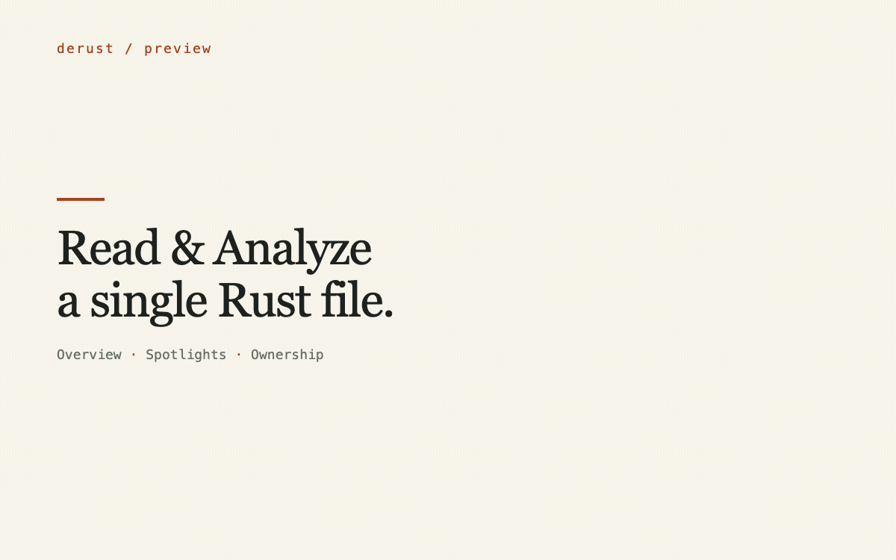
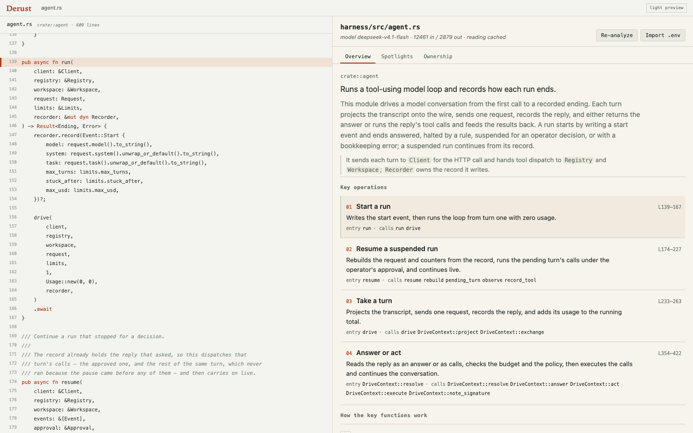
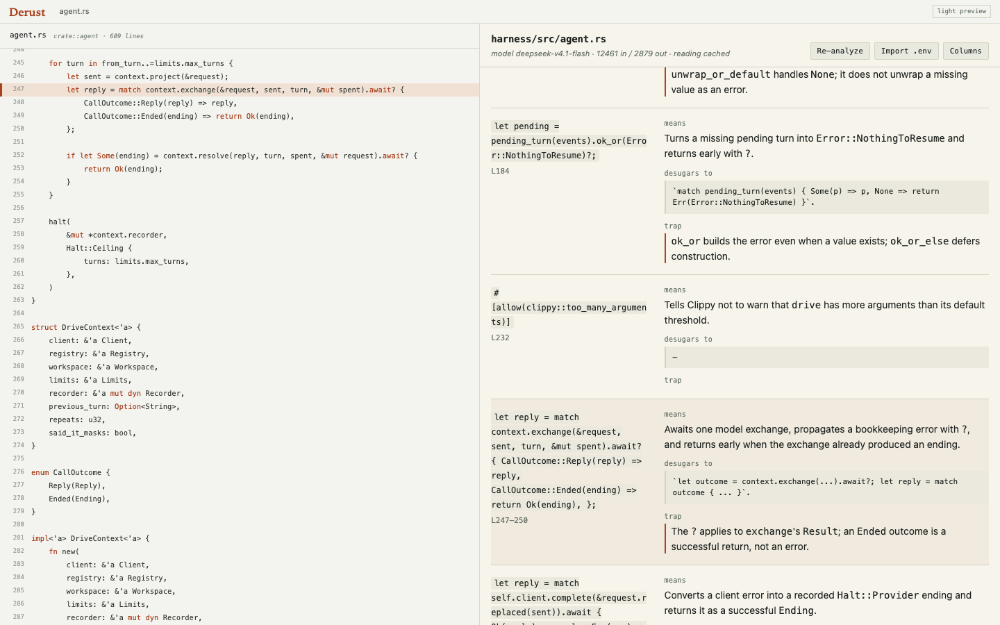
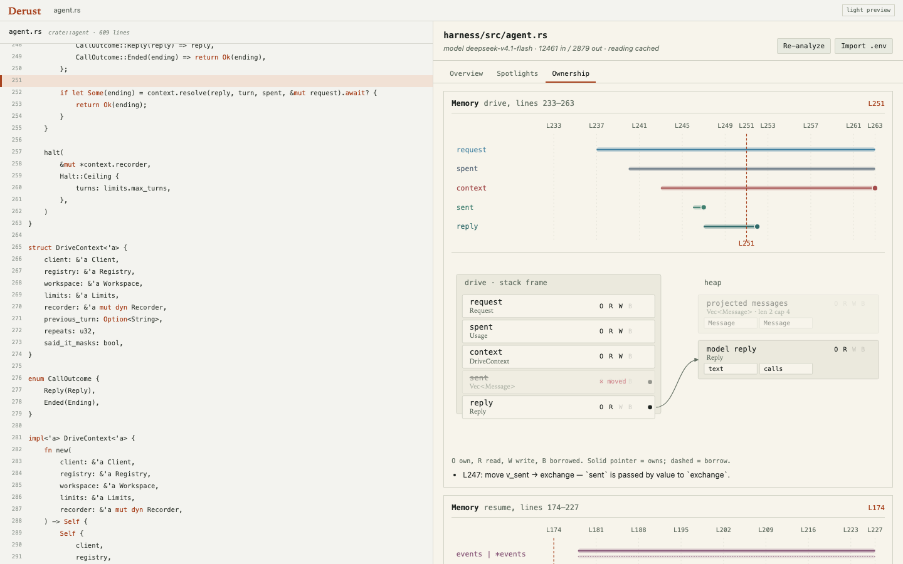
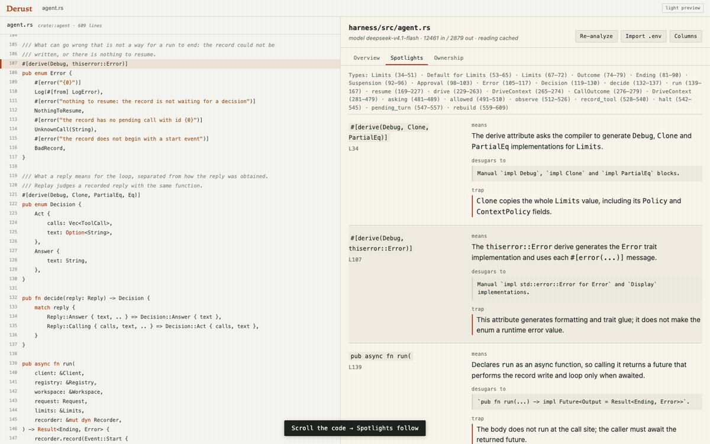

# Derust

Derust is a VS Code extension for reading unfamiliar Rust. It opens a pane
beside the code and explains the file with AI-generated, line-anchored readings:
module behavior, key operations, function walkthroughs, Rust syntax highlights,
ownership, and memory diagrams.

## What it is

Derust has three views:

- **Overview** — the module reading: role, purpose, boundaries, key operations,
  walkthroughs for the key functions, and the rules that need explaining. Before
  a reading exists, it shows a deterministic structural overview built from the
  source.
- **Spotlights** — the Rust constructs that are easy to misread: lifetimes,
  borrows and moves, async, trait objects, derives, attributes, and dense idioms.
  Each one says what it means, what it expands to, and the common trap.
- **Ownership** — memory models for the key functions, with lifetimes, moves,
  borrows, clones, heap objects, and a stack/heap snapshot at the current line.

The reading uses a workspace index built through rust-analyzer for module paths,
public surface, callers, callees, tests, imports, and crate dependencies. The
structural index is built first and cached locally. Call-graph relations are
refreshed in the background and are used by the next reading; the first reading
can use the structural packet while those relations are still being built.

`Read & Analyze` is the single action for the current file. It generates the
module reading first, then the Spotlights and Ownership analysis. The two
artifacts have separate caches, so one can be reused while the other is
regenerated.

## Preview



*Read & Analyze a single file: the module reading opens in Overview, then Spotlights and Ownership fill from the same file analysis.*



*Overview: module role, purpose, key operations, and key-function walkthroughs, anchored to the source.*



*Spotlights: the Rust constructs that are easy to misread, with meaning, expansion, and the common trap.*



*Ownership: memory records for key functions, lifetime lanes, events, and a stack/heap snapshot at the current line.*

## Install

From the Marketplace, search for **Derust**, or install the local VSIX:

```bash
code --install-extension release/derust-0.9.0.vsix
```

For development, open this folder in VS Code and press `F5`.

## Configure

1. Put your provider settings in the workspace `.env`:

   ```dotenv
   LLM_BASE_URL=https://your-provider.example/v1
   LLM_MODEL=your-model
   LLM_API_KEY=…
   ```

   `LLM_BASE_URL` is an OpenAI-compatible base URL. Derust appends
   `/chat/completions`; do not include that path in the base URL.

2. Run **Derust: Import Provider Settings from .env**.

The API key goes to VS Code SecretStorage. The base URL and model are written
to settings.

### Settings

| Setting | Default | Purpose |
|---|---|---|
| `derust.baseUrl` | empty | OpenAI-compatible provider base URL. |
| `derust.model` | empty | Model id sent to the provider. |
| `derust.timeoutSeconds` | `300` | Timeout for one provider request. |
| `derust.maxOutputTokens` | `32768` | Output cap. Reasoning models spend part of it before writing JSON. |
| `derust.reasoningEffort` | `low` | `none`, `low`, `medium`, or `high`; dropped if the provider rejects it. |
| `derust.maxFileLines` | `1200` | Files above this are refused for analysis. |
| `derust.includeDocs` | `true` | Send `DESIGN.md`, `README.md`, and `Cargo.toml` as project context. |
| `derust.jsonMode` | `true` | Request JSON mode; falls back if the provider rejects it. |
| `derust.concurrency` | `2` | Files analyzed in parallel for folder/workspace runs. |
| `derust.maxFiles` | `20` | Ask before a folder/workspace run exceeds this count. |
| `derust.defaultLayout` | `cards` | Spotlight layout: `cards` or `columns`. |
| `derust.restoreLastAnalysis` | `true` | Reopen the last cached reading or analysis at startup. |
| `derust.colorCode` | `true` | Color identifiers in the editor to match memory lanes. |
| `derust.overviewGlance` | `true` | Show the one-line Overview link above the first source line. |
| `derust.briefOnOverview` | `true` | Start the module reading when the Overview opens; turn off to wait for **Read & Analyze**. |

Provider note: reasoning models can consume the whole output budget before
emitting JSON. If a request returns an empty message, raise
`derust.maxOutputTokens` or lower `derust.reasoningEffort`.

## Key commands

| Command | What it does |
|---|---|
| **Derust: Read & Analyze Current File** | Generates the module reading, then Spotlights and Ownership. Shortcut: `Cmd/Ctrl+Alt+R`. |
| **Derust: Analyze Path…** | A single selected `.rs` file uses Read & Analyze; a folder runs analysis for selected files. |
| **Derust: Analyze Workspace** | Runs the Spotlights/Ownership analysis for selected files in the workspace. |
| **Derust: Open Panel** | Opens the cached reading or structural overview for the active Rust file. |
| **Derust: Show File Overview** | Opens the Overview. It may start the reading when `derust.briefOnOverview` is on. |
| **Derust: Rebuild Workspace Index** | Forces a fresh rust-analyzer index. |
| **Derust: Show Index Packet** | Opens the index evidence for the current file. |
| **Derust: Import Provider Settings from .env** | Reads provider settings and stores the key in SecretStorage. |
| **Derust: Clear Analysis Cache** | Removes cached analyses and readings. |

## Navigate the panel

The panel header shows the file, model, line count, and reading state. Its
**Read & Analyze** / **Re-analyze** button is the single action for the current
file. **Import .env** is the provider setup shortcut. In Spotlights, a
**Cards/Columns** button switches the layout.

### Overview

Before a reading exists, the Overview shows the structural summary, top-level
constructs, signatures, and imports. After **Read & Analyze**, it shows:

- role, purpose, and boundaries;
- key operations in execution order;
- how the key functions work, including a summary, a separate **Why** line,
  ordered steps with line ranges, inputs, returns, errors, and side effects;
- rules and edge cases.

Click any operation, function step, rule, or structural row to reveal its source
range in the editor. On the Overview, the panel is the map: clicking a range
moves the editor, but scrolling the editor or moving the caret does not move the
panel.

### Spotlights

Spotlights list the Rust constructs that need explanation. Each card or column
shows the quoted construct, what it means, what it expands to, and, when useful,
the trap. Click a card to reveal its source range. Use **Cards/Columns** to
switch between the compact and comparison layouts.



*Scrolling the code moves Spotlights to the matching construct. Scrolling Spotlights moves the editor to the same range.*

### Ownership

Ownership renders one memory model per key function when the analysis provides
them. Each model contains a lifetime timeline, move/borrow/clone events, and a
stack/heap snapshot at the current line. Click a timeline lane or event to reveal
its source. Move the caret in the editor to update the snapshot. Identifier
coloring follows the timeline lanes (`derust.colorCode`).

### Caches and stale readings

Readings and analyses are cached by file content, model, and prompt version.
They are reused when you reopen a file. A cached result from older source or an
older prompt is marked stale in the header; run **Read & Analyze** again to
refresh it. Startup restoration can reopen the last cached analysis or reading.

## Troubleshooting

- **“Building workspace index…” is taking longer than expected**: the structural
  index is waiting on rust-analyzer. The reading still has the source and
  structural packet; call-graph relations are refreshed separately. Run
  **Rebuild Workspace Index** if the index cache looks stale.
- **A provider error**: check `derust.baseUrl`, `derust.model`, and the API key.
  The **Derust** output channel contains the request error.
- **A file is refused as too long**: raise `derust.maxFileLines`, or split the
  file. Large files cost more and have a higher chance of truncated JSON.
- **The reading exists but Spotlights/Ownership do not**: the two calls are
  independent. Run **Read & Analyze** again; a failed analysis does not erase a
  good reading.

## Data and privacy

Derust sends the selected Rust file, its module context, the prompt, and the
project documents enabled by `derust.includeDocs` to the provider configured in
`derust.baseUrl`. It does not send source code to a default service. The API key
is stored in VS Code SecretStorage; the base URL and model are stored in
settings. Caches live in the extension's global storage and can be removed with
**Derust: Clear Analysis Cache**. The extension has no telemetry.

## Development

```bash
npm install
npm test
```

Press `F5` to launch an Extension Development Host. To build a VSIX:

```bash
npm run package:vsix
```

Release artifacts are written to `release/`.

## Credits

Derust began as a fork of
[Code Explainer Story](https://github.com/trancedu/code-explainer-story) (MIT);
the upstream project is credited in `NOTICE`. The ownership timeline is
inspired by [RustViz](https://github.com/rustviz/rustviz), and the stack/heap
snapshot by [Aquascope](https://github.com/cognitive-engineering-lab/aquascope).
Neither project is affiliated with or endorses Derust. See `NOTICE` for the
full credits and licenses.
